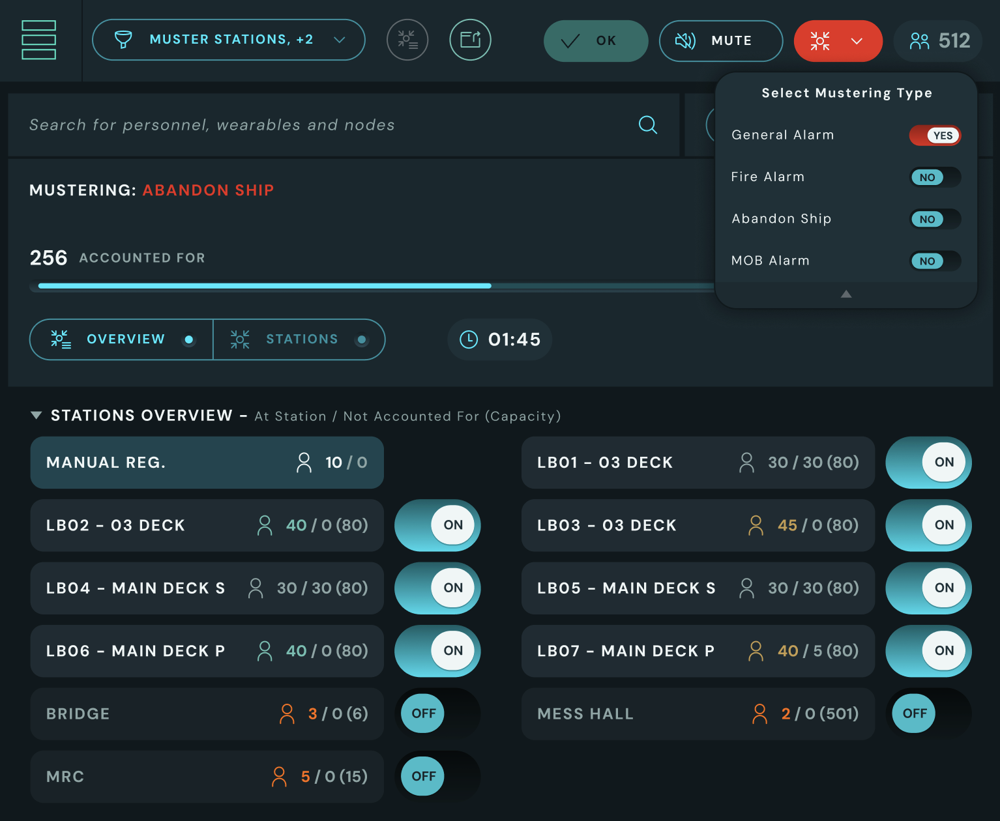
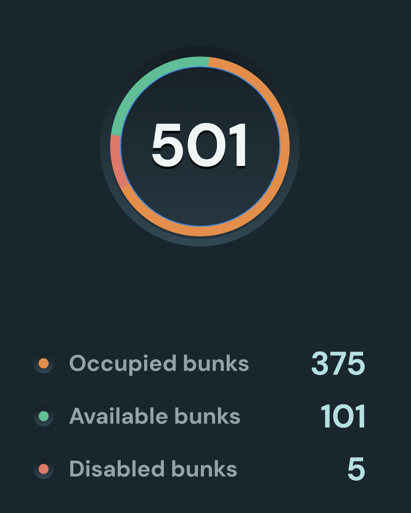
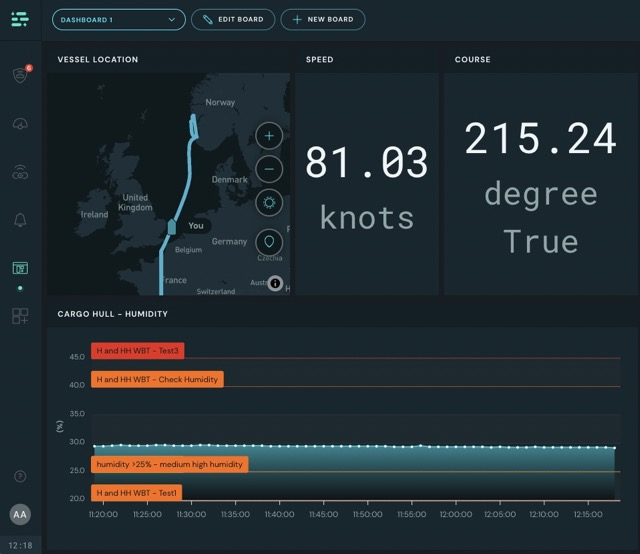

# Release Notes

 

1.24.0 - Mustering update and grouping of nodes

<strong>Introducing Mustering view per muster station and grouping of nodes</strong> 

  
We are excited to announce that we once again have improved the mustering functionality and made it possible to group nodes!

  <h4>Highlights:</h4>
  <ul>
    <li> Enables setting type of Mustering. By default we have added <strong>General Alarm, Fire Alarm, Abandon Ship and MOB Alarm.</strong> If you require other alarms or not all of these, please contact us and we can set it up for you.</li>
    <li> Enabled adding <strong>capacity</strong> to muster station.</li>
    <li>We’ve updated how muster stations are configured. They’re now managed separately from mesh nodes and can be linked to one or multiple nodes to report personnel as a single unit.</li>
    <li>You can now see who is expected at each muster station based on the active type of mustering (alarm). <strong>This feature is only available with an upgraded subscription.</strong></li>
    <li> Upgraded the mustering view to be able show personnel status per muster station. With the extra <strong>Subscription</strong> to assign personnel to muster stations you are able to view who is Accounted For, Not Accounted For <strong>per station</strong> or have met at <strong>other station</strong> than their assigned station</li>
    <li> <strong>Grouped nodes</strong> makes it possible for several nodes to report the number of personnel to a group, to set the total amount of personnel in a selected area.</li>
    <li> In the safety view you can choose to show individual nodes or grouped nodes. The icons in the <strong>GA</strong> will be identified if it is a group of nodes or individual nodes.</li>
    <li> Grouped nodes set up as muster stations will get all personnel from the nodes reporting to them and set them as <strong>Accounted For.</strong></li>
  </ul>

  
If you have any questions regarding these new features you can check our manuals by clicking the “I would like more info” button or contact our sales/support team who will happily help you with any questions.

  
Best regards, The ScanReach Team

1.22.0 - Bunk admin page, crew planning and Gangway Traffic lights

<strong>Introducing New functionality - The Bunk admin page, crew planning and Gangway Traffic lights</strong> 

  <h4>Features:</h4>
  <ul>
    <li>Possibility to add bunks to your vessel and assign personnel to them</li>
    <li>Assign Muster stations to bunks</li>
    <li>Distribute personnel to Muster stations based on bunk assignments</li>
    <li>Crew planning</li>
    <li>Add shift, company and comment field on a person</li>
    <li>Export bunk history</li>
    <li>Enables the possibility of connecting to gangway traffic light hardware and setting traffic light limits</li>
    <li>Vessel location will now be displayed in the top bar if you have a GPS node connected</li>
    <li>Manually setting drop-off location is now handled in the gangway settings pop up</li>
  </ul>
  

    Be aware that Bunk management and Crew planning are only available through an upgraded subscription model. Contact our sales/support team to learn more.
  

  
If you have any questions regarding these new features you can check our manuals by clicking the “I would like more info” button or contact our sales/support team who will happily help you with any questions.

  
Best regards, The ScanReach Team

1.21.0 - Firmware improvements

<strong>Firmware improvements</strong> 

  <h4>Features:</h4>
  <ul>
    <li>Speed and message prioritization firmware improvements</li>
    <li>Verified 1000 wearables in mesh network</li>
  </ul>
  
Best regards, The ScanReach Team

1.20.0 - Improved Bluetooth Integration

<strong>Improved Bluetooth Integration</strong> 

  
We're excited to announce a major upgrade in how our system integrates with Bluetooth sensors!

  
Previously, our platform supported only Ruuvi sensors. With this release, we've expanded the number of Bluetooth sensor types that can be connected to the system, providing you with even more flexibility and functionality.

  
You can now configure and connect up to 7 different Bluetooth sensor types simultaneously, greatly enhancing the versatility of the ScanReach Connect system.

  
Please, note that before adding any new type of Bluetooth sensor to your system, it must undergo a verification process to ensure compatibility. If you have specific Bluetooth sensors or use cases you’d like to explore beyond our current offerings, don't hesitate to reach out!

  
Best regards, The ScanReach Team

1.19.0 - Fuel Type Log Consumption

<strong>Fuel type log</strong> 

  
We are excited to announce a new addition to our Generic Dashboard: the Fuel Type Log widget!

  
This widget allows you to build a log of fuel types used onboard, where you can also add what Density, Sulfur, and Viscosity is used for the different time periods in the log. The log displays the consumed value in kilograms. We believe this will improve fuel consumption monitoring.

  
You can export this data to Excel or CSV files, making it easy to share.

  
If you have any questions about this new feature, click the "I would like more info" button to check our manuals, or contact our support team for assistance.

  
Best regards, The ScanReach Team

1.18.0 - Automatic Vessel Location for gangway operations

<strong>Introducing Automatic Vessel Location for gangway operations!</strong> 

  
We're excited to introduce a significant enhancement in our latest update: Automatic Vessel Location for gangway operations. This feature simplifies offshore operations involving gangway transfers by automatically determining the vessel's location.

  
Key features of this update include:

  <ul>
    <li><strong>Automatic Vessel Location Inference:</strong> The vessel's location is now automatically detected using available GPS data from configured sensors, such as NMEA GPS instruments. This eliminates the need for manual setup and maintenance.</li>
    <li><strong>manual Override Option:</strong> You can still manually override the vessel's location if needed.</li>
    <li><strong>Option to Disable:</strong> If preferred, you can choose to disable this feature entirely.</li>
  </ul>
  
This enhancement ensures accurate transfer locations during offshore operations, enhancing efficiency and reliability.

  
For any questions or assistance, please don't hesitate to reach out to us.

  
Best regards, The ScanReach Team

1.17.0 - Gangway Reporting

<strong>Welcome the new Gangway Reporting feature!</strong> 

  
We're excited to announce a powerful new feature in the ConnectPOB application, making reporting on gangway operations easier than ever!

  <ul>
    <li><strong>Export Personnel Transfer Logs:</strong> You can now export the log of personnel transfers directly from the gangway module. Simply click the "Export Log" button.</li>
    <li><strong>Customizable Reports:</strong> Craft the report you need with a few simple steps:
      <ul>
        <li>Select the data you want to export.</li>
        <li>Filter the selected data according to your needs.</li>
        <li>Select a time frame for your data.</li>
        <li>Choose your preferred export format (Excel or CSV) and download your data.</li>
      </ul>
    </li>
    <li><strong>Save Templates:</strong> Save a report and its settings as a template for future use.</li>
  </ul>
  
For any inquiries or further assistance, feel free to contact us.

  
Best regards, The ScanReach Team

1.16.0 - Extra announcement! OWC Installation App and other improvements

<strong>OWC Installation App is back!</strong> 

  
We're pleased to bring you the latest enhancements in our application:

  <ul>
    <li><strong>Installation App Fix:</strong> The install app is now fixed, allowing you to carry your tablet around to scan nodes and place them accurately within your vessel during installation.</li>
    <li><strong>Node Management Enhancements:</strong> Node details now display the names of connected sensors for clearer information.</li>
    <li><strong>Gangway Configuration Improvements:</strong> GangwayConfigs no longer get stuck in the "updating configuration" state.</li>
    <li><strong>Improved Wearable Management Inventory:</strong> The WearableAdmin now features an improved inventory system for easier management.</li>
    <li><strong>Refined System Issues FAQ Guides:</strong> We've refined our troubleshooting guides in the System Status page to better address common issues.</li>
    <li><strong>Minor Bug Fixes:</strong> Various minor bugs have been fixed to enhance stability and performance.</li>
  </ul>
  
For any inquiries or further assistance, feel free to contact us.

  
Best regards, The ScanReach Team

1.16.0 - Read from multiple Modbus serverIds and Dashboards enhancements

<strong>Exciting Updates: Modbus and Dashboards Enhancements!</strong> 

  
We're thrilled to announce significant improvements in our latest update:

  <ul>
    <li><strong>Read Multiple Modbus Server IDs:</strong> Each Modbus-enabled mesh node can now connect to and retrieve data from multiple Modbus instruments (up to 4) on the same cable. Configure each instrument with a different Modbus server ID directly through our enhanced user interface.</li>
    <li><strong>Dashboards Improvements:</strong> We've enhanced our customizable Dashboards by fixing bugs and simplifying the setup process. Enjoy a smoother experience when creating and managing your Dashboards.</li>
  </ul>
  
These updates enhance flexibility, performance, and ease of use across our platform.

  
For any questions or assistance, please don't hesitate to reach out to us.

  
Best regards, The ScanReach Team

1.15.2 - Unisea and OCS integration improvements!

<strong>Unisea and OCS integration improvements!</strong> 

  
We're excited to announce the latest updates, addressing some key areas to enhance your experience. Here's what’s new:

  <ul>
    <li><strong>Unisea ScanReach Integration Fix</strong>: We've resolved the integration issue, allowing customers to select wearables in the UniSea GUI seamlessly again. Enjoy a smoother and more efficient workflow.</li>
    <li><strong>Unisea and OCS sync enhancements</strong>: We've made significant improvements to the synchronization process with external crew management systems. Now, personnel synced to ConnectPOB will not be marked as 'embarked' until assigned with a wearable. Any such personnel will be marked as 'unresolved', ensuring accurate tracking and accountability.</li>
  </ul>
  
For any inquiries or further assistance, feel free to contact us.

  
Best regards, The ScanReach Team

1.15.0 - Extra Announcement! Launch of the BETA version of Dashboards!

<strong>Launch of the BETA version of Dashboards!</strong> 

  
We are excited to introduce a new feature!

  
You can now create your own fully customizable <strong>dashboards</strong>, displaying exactly the data you need, such as current measurements, trends over time, geolocation data, and anything else collected by your sensors. If a sensor has defined <strong>alarm thresholds</strong>, these will also be displayed, making it easy to monitor your data.

  
It is possible to create and save as many dashboards as you want and choose the best suited one for each situation.

  
To use the new feature click the <strong>new icon</strong> in the left side menu that looks like this:

  
  
<strong>Important note</strong>: This feature is currently in <strong>BETA</strong>, and we're actively refining it. Your feedback and questions are therefore appreciated — please reach out to us.

1.15.0 - Mustering Improvements

<strong>Enhanced Mustering Features!</strong> 

  
 Dear ScanReach Users,

  
We've heard your concerns about the mustering functionality and have diligently addressed them. Here's a summary of the improvements in our latest update:

  <ul>
    <li>Increased the size of columns in personnel lists for improved visibility.</li>
    <li>Added a toggle for <b>manual registration</b>, allowing users to manually register personnel as <i>Accounted For</i>.</li>
    <li>Introduced an Auto Muster mode with two options:
      <ul>
        <li>Auto Muster <b>ON</b>: System automatically adds personnel detected at muster stations to the "Accounted For" list.</li>
        <li>Auto Muster <b>OFF</b>: System only indicates personnel detected at muster stations, enabling manual registration to the "Accounted For" list.</li>
      </ul>
    </li>
    <li>Enhanced ConnectPOB usability on tablets during muster situations, displaying the same information as on desktops.</li>
    <li>Clearly shows when the system is offline without disrupting your usage.</li>
    <li>Search and manually register personnel not listed in "Accounted For" or "Not Accounted For" lists.</li>
  </ul>
  
For inquiries or further assistance, feel free to contact us.

  
Best regards, The ScanReach Team

1.14.2 - Sensor alarm thresholds in charts

<strong>Enhanced Chart Insights in Latest Update!</strong> 

  
Dear Valued Users,

  
We're excited to introduce a valuable enhancement to elevate your experience.

  
Now, you have the option to display sensor-alarm <strong>thresholds</strong> directly on the chart, providing insightful connections to the measurements you're visualizing. Stay informed and in control with this new feature!

  
Best regards, The ScanReach Team

1.14.2 - Improved access restrictions

<strong>Enhanced Data Control Features in Latest Update!</strong> 

  
Dear Valued Users,

  
In response to your invaluable feedback, we are thrilled to announce a significant update that empowers you with greater control over data access within your organization.

  
With this latest release, you can now precisely define the type of data accessible to <em>Viewer</em> members, differentiating between <strong>POB</strong> and <strong>Sensor data</strong>. Moreover, we have enhanced access restrictions, allowing you to specify not only the vessels within your fleet but also the exact time periods during which such data should be accessible to these users.

  
Thank you for inspiring us to make your experience even better.

  
Best regards, The ScanReach Team

1.14.1 - Virtual Sensor

<strong>Introducing the new Virtual Sensors feature!</strong> 

  
Now, in addition to managing physical sensors and instruments, the Connect platform allows you to create <b>dynamic</b> and <b>custom measurements configurations</b> by harnessing the power of custom mathematical formulas.

  
For example, you can combine and manipulate data collected from multiple sensors, regardless of their types, to generate brand new measurements tailored to your specific needs.

  
Imagine the possibilities: calculating derived values, performing complex transformations, or even simulating sensor outputs based on intricate algorithms.

  
You can easily start configure a new Virtual Sensor by clicking the "add configuration" button in the top application bar, and selecting the "Virtual" configuration type.

